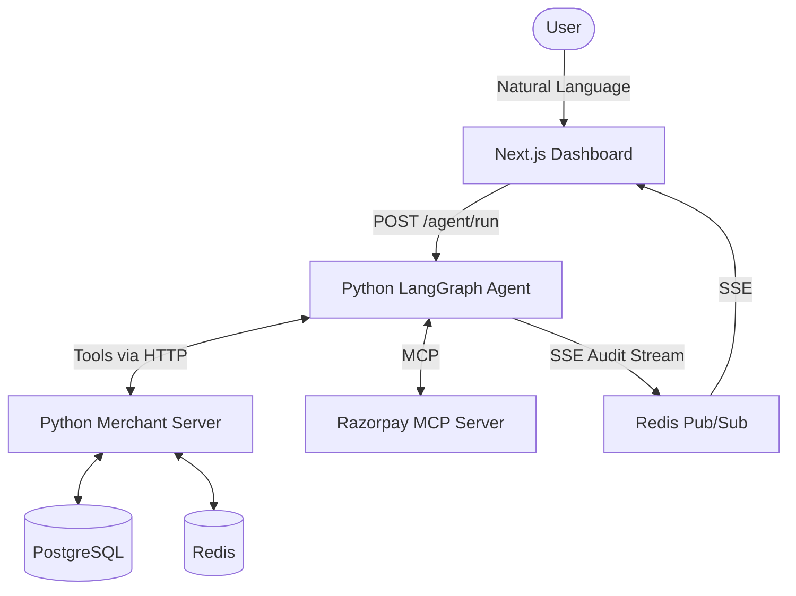

# PayAgent - Autonomous AI Shopping Assistant

> An AI agent that shops for you. Search → Cart → Pay - fully autonomous with human-in-the-loop safety.


## What It Does
PayAgent is an autonomous shopping assistant that accepts natural language goals (e.g., "Buy running shoes under ₹2000"). It uses LangGraph to independently query a product catalog, build a shopping cart, and present a Razorpay checkout session to the user, strictly adhering to predefined spending guardrails.

## Architecture


## Features
- **Autonomous AI shopping agent** (LangGraph + Groq Llama 3)
- **Live Cart Context Injection**: Agent dynamically queries Redis for live cart state to prevent hallucinations.
- **Robust Error Recovery**: API rate limits handled gracefully using `tenacity` exponential backoffs.
- **Spending Guardrails**: Configurable limits to auto-reject expensive carts.
- **Human-in-the-Loop Checkout**: Final payment approval is safely delegated to the human user.
- **Real-Time Audit Trail**: Seamless event streaming via Server-Sent Events (SSE) and Redis Pub/Sub.
- **Razorpay Integration**: Official Razorpay Node MCP (Model Context Protocol) Server for secure checkout.
- **Voice Input**: Web Speech API integration for hands-free shopping.
- **Interactive Analytics**: Dashboard for session and order tracking.

## Quick Start

### The Easy Way
You can run the entire stack using the provided bash scripts.
```bash
./start.sh
```
This will start Docker, the Python server, the Python AI agent, and the Next.js dashboard in the background. The logs are cleanly captured in the `logs/` directory.

To stop everything when you're done, run:
```bash
./stop.sh
```

Navigate to [http://localhost:3000](http://localhost:3000) to begin!

### Manual Setup (Alternative)
If you prefer running services manually:

**1. Start Database & Redis**
```bash
docker compose up -d
```

**2. Start Python Merchant Server**
```bash
cd merchant-server-py
pip install -r requirements.txt
cp .env.example .env
uvicorn main:app --reload --port 8000
```

**3. Start Python AI Agent**
```bash
cd ai-agent
Python3 -m venv venv
source venv/bin/activate
pip install -r requirements.txt
cp .env.example .env # Add GROQ_API_KEY
Python3 -m uvicorn main:app --port 8001
```

**4. Start Next.js Dashboard**
```bash
cd dashboard
npm install
npm run dev
```

## Demo Scenarios
Try these queries on the dashboard:
1. `Buy running shoes under ₹2500`
2. `Find wireless earbuds under ₹1500`
3. `I need a laptop bag for college`
4. `Get me a book on system design`
5. `Buy a smartwatch under ₹2000`

## Tech Stack
| Component | Technology | Description |
|-----------|------------|-------------|
| **Frontend** | Next.js 14, React, Recharts | Sleek dashboard with Server-Sent Events (SSE), voice input, and charts. |
| **Backend API** | Python , PostgreSQL | Blazing fast merchant API managing catalog, cart logic, and orders. |
| **Agent Core** | Python, LangGraph | State machine, tool execution, and dynamic context injection. |
| **LLM Provider** | Groq (Llama 3) | Low-latency inference engine for the conversational interface. |
| **Caching & Pub/Sub** | Redis | Ephemeral cart states and real-time pub/sub pipeline for audit trails. |
| **Payments** | Node.js, Razorpay MCP | Secure payment intent creation via Model Context Protocol. |

## Project Structure
```
payagent-core/
├── ai-agent/
│   ├── api/
│   │   └── routes.py
│   ├── ...
│   └── main.py
│
├── dashboard/
│   ├── app/
│   │   ├── api/
│   │   └── session/
│   ├── components/
│   ├── lib/
│   ├── package.json
│   └── ...
│
├── merchant-server-py/
│   ├── routers/
│   │   └── order.py
│   └── ...
│
├── db-init/
│   └── ...
├── logs/
│   └── ...
├── docker-compose.yml
├── start.sh
├── stop.sh
└── README.md
```

## License
MIT
